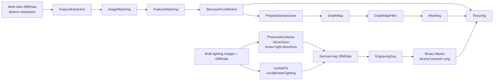

# EngravingSeg Meshroom plugin

This plugin wraps [`src/predict_image.py`](src/predict_image.py) as a Meshroom node. It processes every view in an
input SfMData, using tiled Keras inference, and writes a grayscale probability map per view. The output SfMData
preserves the input views, poses and intrinsics while pointing each view to its generated prediction map.
The input SfMData must reference normal-map images, for example normal maps generated by a photometric-stereo (PS)
pipeline.

## Requirements and installation

TensorFlow 2.15.1 supports Python 3.10 and 3.11; use a compatible Meshroom Python environment. `psutil` is included
for Meshroom's compute process. On Linux, the `and-cuda` extra installs the CUDA 12.2 and cuDNN libraries required
by TensorFlow; a compatible NVIDIA driver is still required. TensorFlow automatically uses a detected GPU for
supported operations and otherwise runs on CPU. From this directory:

```bash
UV_PROJECT_ENVIRONMENT=venv uv sync
export MESHROOM_PLUGINS_PATH="$PWD:$MESHROOM_PLUGINS_PATH"
```

For PowerShell:

```powershell
$env:UV_PROJECT_ENVIRONMENT = "venv"
uv sync
$env:MESHROOM_PLUGINS_PATH = (Get-Location).Path
```

The `EngravingSeg` node appears in the **Segmentation** category. On its first computation it downloads the
selected model from Google Drive using `gdown`; subsequent computations reuse the file in `weights/`. A custom `.h5`
model can be provided through **Model File** instead.

## Node parameters

| Parameter | Default | Description |
|---|---:|---|
| SfMData | — | SfMData whose views reference normal-map images, e.g. generated by photometric stereo (`.sfm` or `.json`; other formats require pyalicevision) |
| Model | `dbos_50ep` | Select `dbos_50ep` or `limeuil10_50ep` |
| Mask or Mask Folder | — | Optional black-and-white mask shared by all views, or a folder with masks named `<viewId>` or after the source image; white pixels are included and black pixels are excluded from the output |
| Stride | `256` | Pixel step between patches; cannot exceed Patch Size |
| Patch Size | `512` | Square input patch size |
| Tiles per Batch | `8` | Number of tiles inferred together; increase to improve GPU utilization, or reduce if GPU memory is insufficient |
| Normalization | `standard` | `standard`, `simple`, or `none` |
| Binary Threshold | `127` | Grayscale prediction values strictly above this value become white (`255`) in the binary mask; other pixels become black (`0`) |
| Model File | — | Optional custom Keras `.h5` model |

## Node outputs

| Output | Path | Description |
|---|---|---|
| Output Folder | `{nodeCacheFolder}` | Cache directory containing all generated files |
| Output SfMData | `{nodeCacheFolder}/engravingSeg.sfm` | Copy of the input SfMData with image paths pointing to the grayscale probability maps |
| Engravings Maps | `<poseId>.png` | Grayscale probability map for each pose; visible in Meshroom's image viewer |
| Binary Masks | `binary/<poseId>.png` | Thresholded black-and-white segmentation mask for each pose; visible in Meshroom's image viewer |

## Template exemple

The graph below shows one possible workflow. The calibrated and uncalibrated photometric-stereo branches are
alternatives; choose the one matching the acquisition and available light information. The photogrammetry branch
builds a mesh independently from images captured at different viewpoints.



Use a multi-view SfMData whose images cover distinct viewpoints for the photogrammetry branch; the multiple-light
images grouped for PS are not in themselves multiple viewpoints. In `Texturing`, connect that SfMData to
**Input**, the `Meshing` result to **Mesh**, and the binary-mask folder to **Images Folder**. AliceVision's
`Texturing` matches files in that folder by image UID. EngravingSeg names masks by `poseId`; if these IDs differ
from the image UIDs in the SfMData connected to `Texturing`, copy or rename the masks to the corresponding UID
filenames first. The resulting texture uses the binary masks (black and white) instead of the original photographs.

## Development

### Test
From the project directory, synchronize the project environment and run the test suite with `pytest` supplied
temporarily by `uv`:

```bash
UV_PROJECT_ENVIRONMENT=venv uv sync
UV_PROJECT_ENVIRONMENT=venv uv run --frozen --with pytest python -m pytest -q
```

For PowerShell:

```powershell
$env:UV_PROJECT_ENVIRONMENT = "venv"
uv sync
uv run --frozen --with pytest python -m pytest -q
```

### Plugin Structure

```text
mrEngravingSeg/
├── meshroom/
│   └── EngravingSeg/
│       ├── EngravingSeg.py   # Meshroom node: UI parameters, outputs, model loading and processChunk
│       └── __init__.py       # Makes the node package discoverable by Meshroom
├── src/
│   ├── predict_image.py      # Tiled Keras inference, input masks, probability and binary PNG output
│   └── sfm_data.py           # SfMData I/O, view/mask resolution and per-pose prediction orchestration
├── tests/
│   ├── test_predict.py       # Image prediction, mask application and threshold tests
│   └── test_sfm_data.py      # SfMData and mask/output-path tests
├── weights/                  # Bundled pretrained .h5 models (also the cache for downloaded models)
├── pyproject.toml             # Project metadata, Python constraints and runtime dependencies
├── requirements.txt           # Pip-compatible runtime dependency list
├── uv.lock                    # Locked dependency versions for uv
└── README.md
```

At runtime, Meshroom discovers `meshroom/EngravingSeg` and calls the node's `processChunk`. The node loads the
input SfMData and Keras model, then delegates view and pose handling to `src/sfm_data.py`. That module resolves
each source image and its optional mask, calls `src/predict_image.py` for tiled inference, and updates the copied
SfMData with the generated probability-map paths. The predictor saves the grayscale map as `<poseId>.png` and the
thresholded binary mask as `binary/<poseId>.png` in the node cache. Unit tests cover the prediction and SfMData
layers independently of Meshroom.


---

## Citation

- **De la détection au relevé: une simple question d’apprentissage ?**  
  A. Laurent, N. Rottier, L. Bayel, et al. In : IA et Patrimoine. 2025.
  [Code](https://github.com/steno3/detection_gravure)
